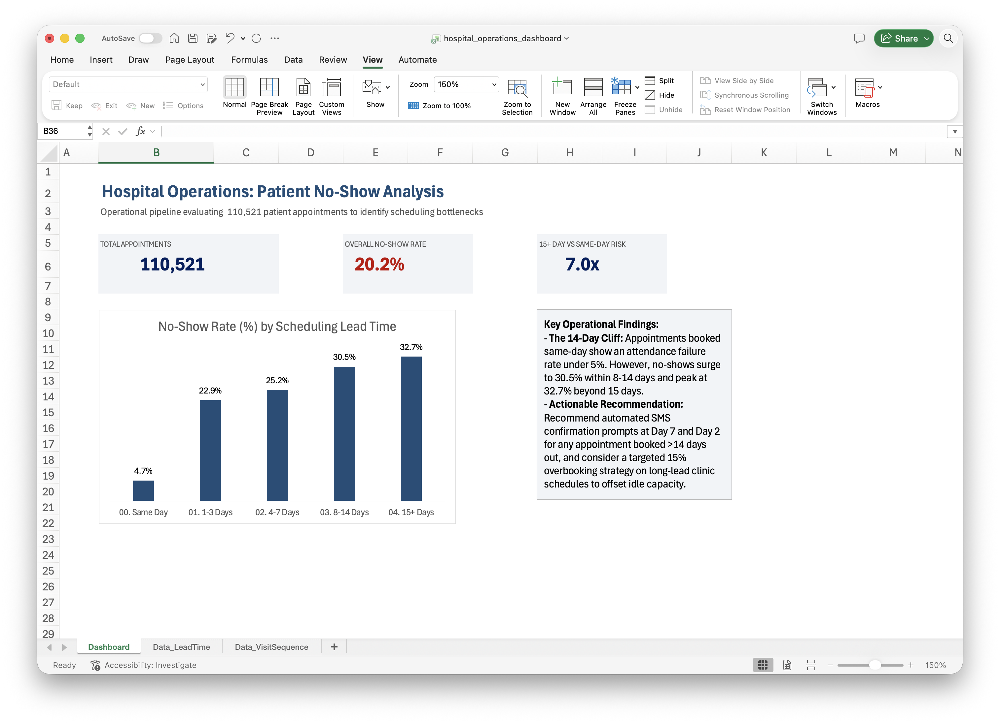

# Healthcare Operational Analytics & ETL Pipeline

An end-to-end data engineering and analytics pipeline evaluating **110,521 patient appointments** to identify scheduling bottlenecks and operational drivers behind patient no-shows.



## Business Problem
Missed medical appointments leave clinic rooms idle, reduce provider utilization, and delay patient care. This project transforms raw appointment logs into a normalized relational database to answer two core operational questions:
1. How strongly does scheduling lead time (wait days between booking and visit) impact attendance?
2. Are no-shows driven by repeat offenders or first-time visitors?

## Architecture & Tech Stack
* **Python & Pandas:** Automated ingestion, data hygiene, outlier removal, and feature engineering (`lead_time_days`).
* **SQLite & Relational Modeling:** Normalized star-schema design (`dim_patient` and `fact_appointment`) enforcing primary/foreign key integrity.
* **Intermediate SQL:** Multi-table `JOIN`s, `CASE WHEN` cohort binning, Common Table Expressions (CTEs), and `ROW_NUMBER()` Window Functions.
* **Microsoft Excel:** Executive KPI dashboard displaying attendance metrics and lead-time risk trends.

## Key Findings & Recommendations
* **The 14-Day Lead-Time Cliff:** Same-day appointments maintain a **4.7%** no-show rate, whereas bookings scheduled 15+ days in advance jump to **32.7%** (**7.0x** higher risk).
* **Flat Repeat-Visit Risk:** Window function sequencing shows no-show rates remain steady (~19.5%–21.4%) from a patient's 1st visit through their 4th+ visit, confirming wait time—not repeat patient behavior—is the primary driver.
* **Operational Recommendation:** Implement automated SMS reminders at Day 7 and Day 2 for bookings scheduled >14 days out, and apply targeted overbooking buffers for long-lead slots.

## Project Structure
```text
healthcare-etl-pipeline/
├── data/
│   ├── raw/                  # Raw source CSV (ignored in Git)
│   └── processed/            # Cleaned data, aggregated KPIs, and Excel workbook
├── screenshots/              # Dashboard preview images
├── scripts/                  # Modular Python ETL & analytics pipeline
│   ├── 01_inspect_data.py
│   ├── 02_clean_data.py
│   ├── 03_load_db.py
│   └── 04_run_sql_analytics.py
├── sql/                      # Standalone DDL schema & analytical SQL queries
│   ├── 01_create_schema.sql
│   └── 02_analytical_queries.sql
└── README.md
'''

## How to Run
1. Download the Medical Appointment No-Shows dataset https://www.kaggle.com/datasets/joniarroba/noshowappointments , renaming it to `appointments.csv` and save it to `/healthcare-etl-pipeline/data/raw`.
2. Execute the pipeline sequentially from the `scripts/` folder:
	`python3 01_inspect_data.py`
	`python3 02_clean_data.py`
	`python3 03_load_db.py`
	`python3 04_run_sql_analytics.py`
